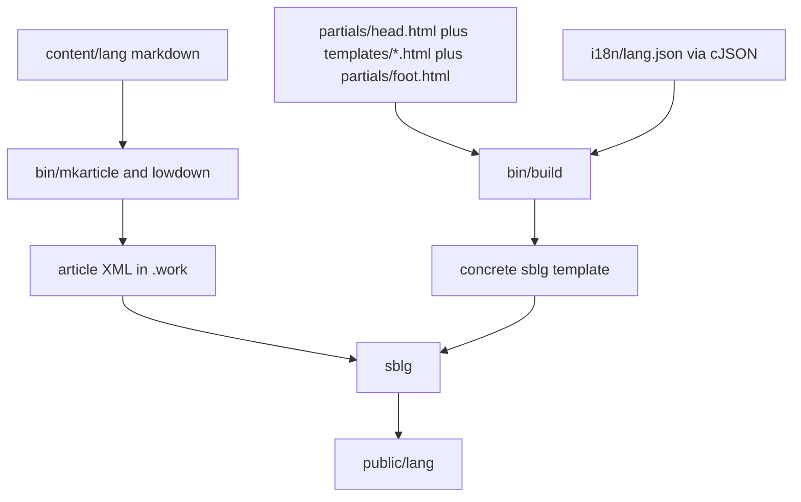

# Portfolio

Personal portfolio of Antoni Aloy Torrens, built as a static, multilingual site
with [**sblg**](https://kristaps.bsd.lv/sblg/) and
[**lowdown**](https://kristaps.bsd.lv/lowdown/), driven by `make`.

Languages: **Catalan (ca)**, **Spanish (es)**, **English (en)**. Catalan is the
source language.

## Requirements

| Tool             | Used for                                              |
|------------------|-------------------------------------------------------|
| `clang`          | compiling `bin/build`, `bin/mkarticle` and tests      |
| `llvm`           | `llvm-cov` and `llvm-profdata` (coverage)             |
| `pkg-config`     | locating `libcjson` at compile time                   |
| `libcjson-dev`   | JSON for `i18n/*.json` (`libcjson`)                   |
| `sblg`           | merging article fragments into templates              |
| `lowdown`        | Markdown → (XML-well-formed) HTML                     |
| `make`           | orchestration                                         |
| `mini-httpd`     | `make serve` / `make run` (`mini_httpd`)              |
| `rsync`          | `make rsync`                                          |
| `curl`           | `make update-external` only                           |
| `clang-tidy`     | clang-tidy report for SonarQube                       |
| `cppcheck`       | static analysis report for SonarQube                  |
| `flawfinder`     | security report for SonarQube                         |
| `lcov2cobertura` | package that provides `lcov2xml` (LCOV to Cobertura)  |
| `sonar-scanner`  | upload the reports (`make sonarqube`)                 |
| Unlighthouse     | `make lighthouse` (npm global in `portfolio-ci` image)|
| Chrome/Chromium  | headless browser for Unlighthouse                     |

`make` compiles the C tools, then `bin/build` runs the site build. Article
dates are formatted in that code (ca/es/en month names), not with libc
locales. `curl` is only for refreshing the copies under `external/`.

## Build

```sh
make            # build everything into public/
make build-one LANG=ca   # build a single language
make test       # unit tests (Unity)
make coverage   # Cobertura XML in build/report/
make scan-sonar # cppcheck, clang-tidy and flawfinder reports
make run        # serve public/ with mini_httpd (HOST/PORT)
make lighthouse # Unlighthouse crawl from /ca/ (ephemeral port; perf, a11y, best-practices, seo)
make sonarqube  # cxx reports, coverage, lighthouse, then sonar-scanner
make serve      # build, then serve public/ at http://127.0.0.1:8080
make clean      # remove public/, .work/, build/ and the compiled binaries
make rsync REMOTE_HOST=… REMOTE_USER=… REMOTE_PATH=…   # deploy
make update-external     # refresh Unity and stb_ds
```

## How it works

sblg has **no template logic** (no conditionals, no loops, no global variable
substitution). It only does article and navigation listing, plus per-article
`${sblg-*}` symbols. So all per-language UI text and per-page values are baked
into the templates *before* sblg runs.


