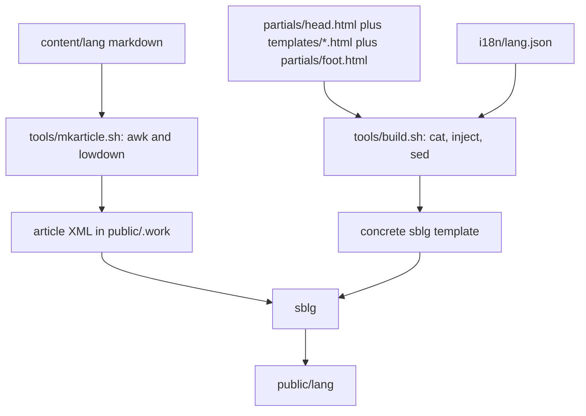

# Portfolio

Personal portfolio of Antoni Aloy Torrens, built as a static, multilingual site
with [**sblg**](https://kristaps.bsd.lv/sblg/) and
[**lowdown**](https://kristaps.bsd.lv/lowdown/), driven by `make`.

Languages: **Catalan (ca)**, **Spanish (es)**, **English (en)**. Catalan is the
source language.

## Requirements

| Tool          | Used for                                       |
|---------------|------------------------------------------------|
| `sblg`        | merging article fragments into templates       |
| `lowdown`     | Markdown → (XML-well-formed) HTML               |
| `jq`          | reading the JSON translation catalogs          |
| `make`        | orchestration (`tools/build.sh`)               |
| `awk` + `sed` | the build helpers (no scripting runtime needed) |
| `mini-httpd`  | `make serve` (`mini_httpd`)                    |
| `xmllint`     | (optional) well-formedness checks              |

The build uses only POSIX text tools plus `jq`; there is no Python or other
interpreter to install.

## Build

```sh
make            # build everything into public/
make build-one LANG=ca   # build a single language
make serve      # build, then serve public/ at http://127.0.0.1:8080
make clean      # remove public/
make rsync REMOTE_HOST=… REMOTE_USER=… REMOTE_PATH=…   # deploy
```

Output goes to `public/` (git-ignored). The site root `/` is **not** generated:
language selection is done by the web server (see `deploy/nginx.conf.example`).

## How it works

sblg has **no template logic** (no conditionals, no loops, no global variable
substitution). It only does article and navigation listing, plus per-article
`${sblg-*}` symbols. So all per-language UI text and per-page values are baked
into the templates *before* sblg runs.


